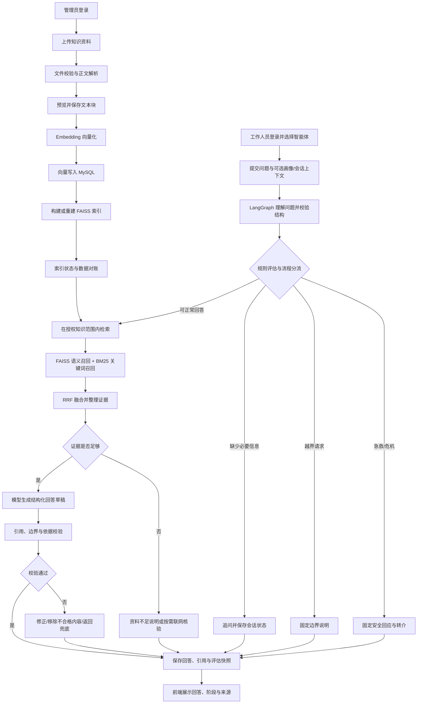

# 颐养通 · 养老院智能照护协作平台 项目介绍

> 角色与范围更新（2026-11-02）：按后续确认新增老人账号，当前角色为管理员、工作人员、老人；管理员仍只有一种权限且可有多个账号。老人账号须由管理员一对一绑定档案，已实现本人只读入口；每日菜单、选餐及餐食页 Agent 待实现，独立膳食营养师暂缓升级。旧的“两角色、老人不登录”描述由此更新取代。操作见[老人账号与档案绑定说明](../03-使用说明/老人账号与档案绑定说明.md)。

> 实现进度补充（2026-11-02）：老人档案首版已加入代码，含负责人员授权和变更记录；需执行迁移 0014 后使用。空间床位、任务及交接业务仍待实现。见[老人档案使用说明](../03-使用说明/老人档案使用说明.md)。

## 项目概览与整体流程

> 更新日期：2026-11-02。项目定位调整为面向养老院管理员和工作人员的智能照护协作平台。基于现有六个 Agent、RAG、账号和私人会话，规划老人档案、照护任务、异常处理和交接班。本轮为文档升级，新增机构业务尚未实现。后续第 2～8 节保留已有咨询与检索技术链路说明，不代表养老院业务已经接通。

## 1. 项目定位与参与角色

颐养通服务养老院日常照护工作，目标是让工作人员围绕授权老人完成“查看档案—执行任务—登记情况—上报异常—交接确认”，由智能体辅助查询知识、整理信息并生成待确认草稿。

产品暂保留两类账号：管理员、工作人员。管理员只设计一种权限角色，可对应多个独立账号；不细分系统管理员、院长、护理主管等角色。护理员、医护等岗位可以作为人员资料，后续是否形成独立权限另行评估。

| 对象 | 主要工作 | 权限边界 |
| --- | --- | --- |
| 管理员（可多个账号） | 管理本院基础资料、员工、老人分配、任务、异常、知识资料 | 不因角色自动读取其他人的私人聊天；重要操作留痕 |
| 工作人员 | 查看负责老人、执行任务、记录和交接、使用六个 Agent | 升级目标为经管理员开通后按负责范围访问；当前普通账号尚未具备员工准入和老人授权流程 |
| 老人 | 接受照护、具有独立档案 | 本期不作为登录角色；与提问的工作人员身份分开 |
| 智能体服务 | 知识查询、解释、风险提示与草稿辅助 | 不自动修改医嘱、档案或正式任务，不替代专业判断 |

知识库与 RAG 的维护仅管理员可用，工作人员通过智能体使用其中的知识。老人个人资料保存在业务数据库，按授权读取，不作为公共向量资料。

### 1.1 现有基础和新增规划

现有基础：Vue 3、FastAPI、LangGraph、Qwen、MySQL、FAISS、Embedding + BM25 + RRF、Tavily、六个 Agent 基础实现、登录与管理员权限、按账号隔离的会话、个人本地提醒及当前账号最近对话。

新增规划：房间床位、老人档案、员工准入与人员分配、数据库照护任务、测量记录、异常业务流、交接班、Agent 授权老人上下文、机构知识审核。管理员既有演示数据不自动转为正式机构业务数据。

### 1.2 升级后的工作主线（待实现）

管理员建档与分配→工作人员执行任务→登记照护和测量→异常上报与管理员跟进→交接提交与接收。Agent 辅助发生在这条流程中，正式记录均需人员确认提交。

完整需求见[项目需求文档](项目需求文档.md)，实施顺序见[项目规划书](项目规划书.md)。部署配置仍放到业务实现和验收之后补充。

## 2. 项目端到端流程

平台有两条相互衔接的主流程：管理员先把资料加工成可检索的知识；用户提问时，智能体在允许的知识范围内召回证据并生成回答。FAISS 提供向量检索能力，MySQL 保存文本块、向量、会话和业务状态。

## 3. 知识资料入库与检索准备

### 3.1 上传与解析

1. 管理员登录后选择知识库并上传资料。系统校验文件类型、文件大小和内容是否为空。
2. 后端为原始文件生成随机存储名，保存文件并在 MySQL 记录文档名称、知识库、来源、状态等元数据。
3. 解析服务提取文档正文。当前支持 TXT、Markdown、文字型 PDF 和 DOCX；扫描件 OCR、加密文件和旧版 DOC 不在当前解析能力范围内。
4. 解析成功后，正文和解析状态写入 MySQL；解析失败时记录原因，管理员可以重试。

### 3.2 切块与向量化

1. 管理员设置切块大小和重叠范围，先预览分块结果，再确认保存。
2. 每个文本块保留所属文档、顺序号以及在解析正文中的字符起止位置。重新切块会使旧向量失效，相关索引状态需要更新。
3. 管理员创建 Embedding 任务。后端按批次调用 Embedding 服务，并检查返回条数、维度、数值有效性和向量范数。
4. 通过校验的向量序列化为 float32，连同模型标识和维度保存到 MySQL；任务状态、进度、批次结果和错误信息也会持久化，失败任务支持重试。

### 3.3 FAISS 索引构建与检索

1. 索引服务从 MySQL 读取符合条件的文本块向量，按文本块 ID 构建 FAISS `IndexIDMap2(IndexFlatIP)` 索引。
2. 索引文件是 MySQL 数据的派生结果；文档正文、文本块和向量仍以 MySQL 为数据来源。索引丢失或需要恢复时，可根据 MySQL 中的向量重建。
3. 用户检索时，查询问题生成 Embedding 后进入语义召回；同时对授权范围内的文本块执行 jieba 分词和 BM25 关键词召回。
4. 两路候选结果通过 RRF 排序融合，再按配置返回相关文本块。检索结果包括来源文档和文本块原文位置，供回答引用及前端定位。
5. 检索范围由智能体后端配置限定，不能由用户通过问题参数扩大。检索记录保存查询条件和结果快照，便于管理员回看。

## 4. 用户咨询与智能体回答

### 4.1 登录、选 Agent 与建立会话

1. 用户注册或登录后获得有效会话凭证；前端路由根据登录状态和角色控制页面访问，后端接口再次校验身份和角色。
2. 用户从健康、用药、政策、膳食、安全、心理六个入口中选择对应智能体。
3. 用户创建新会话或继续已有会话。请求可以携带问题、会话标识、已有对话、已确认的个人条件或领域画像。
4. 后端按会话所有者校验访问权限，加载当前智能体对应的会话状态和已保存的条件。会话历史用于理解上下文，不会自动成为知识证据。

### 4.2 问题理解与确定性规则

1. LangGraph 工作流接收问题与允许使用的上下文，由模型识别问题意图、必要条件、检索问题及结构化字段。
2. Pydantic 校验模型输出。若结构不符合约定，按当前工作流的有限策略修正或返回明确错误，不把格式错误当成有效答案。
3. 领域服务在检索和生成前执行确定性评估，例如健康指标分级、用药相互作用和不良事件检查、膳食风险判断、居家隐患与跌倒分级、心理危机识别等。
4. 工作流依据评估结果进入不同分支：

| 分支 | 处理方式 |
| --- | --- |
| 急救或危机风险 | 返回程序控制的安全提示和求助路径；不进入常规资料检索与答案生成 |
| 超出智能体职责或属于禁止请求 | 给出边界说明和适当的转介方向 |
| 缺少决定性条件 | 提出有限的澄清问题，并保存用户已明确的条件，后续可续答 |
| 普通咨询 | 进入该智能体配置的知识检索流程 |

### 4.3 证据检索与生成

1. 后端结合用户原问题、理解结果和对话状态形成检索查询，并将查询限制在当前 Agent 的知识库范围。
2. 检索服务执行 FAISS 语义召回与 BM25 关键词召回，使用 RRF 融合候选结果。召回片段会带有文档、文本块及原文位置等信息。
3. 若资料不足，系统按智能体策略返回“资料不足”或使用补充信息源。政策顾问可以在本地资料无命中、需要时效核验或模型判断依据不足时按需调用 Tavily；网页结果会单独标记为网络来源，不自动写入知识库。
4. 有可用证据时，模型根据问题、规则评估结果和检索片段生成结构化草稿。答案按段组织，每段标明其引用来源。

### 4.4 回答校验、保存与展示

1. 后端检查草稿结构、业务边界、引用编号是否属于本次检索结果，以及回答中的关键内容是否满足对应 Agent 的校验规则。
2. 校验不通过时，根据问题类型执行有限修正；不合格段落会被拦截，证据不足时返回兜底说明，不把无依据草稿当作成功回答。
3. 校验通过后，系统保存用户问题、回答、引用、领域评估结果、检查快照和当前处理状态。
4. 前端展示回答、引用来源、业务风险信息及处理阶段。用户可以打开来源并回看对应原文位置；刷新后从数据库回放已有答案，不重新调用模型。
5. 用户继续追问时，系统加载会话状态和此前明确的条件，避免重复询问，并为新一轮重新执行相应评估和检索。

## 5. 六类智能体的流程差异

六类 Agent 共用“问题理解—规则评估—检索—生成—校验—持久化”的工作模式，各自使用独立的领域服务、知识范围、风险分支和回答结构。

| 智能体 | 重点识别与规则 | 典型分流或回答内容 |
| --- | --- | --- |
| 政策顾问 | 地区、服务类别、适用条件与政策时效 | 条件不足时追问；本地资料不足或需要时效核验时可联网查找；金额和适用范围需要证据支撑 |
| 健康管家 | 血压、血糖、血氧等指标及急症信号 | 先做风险分级；急症风险进入固定求助路径，普通健康问题检索知识并附来源 |
| 用药管家 | 药名识别、相互作用、不良事件与用药边界 | 风险事件优先分诊；加减停换药等请求进入边界说明，不生成个体化处方 |
| 膳食营养师 | 疾病、营养目标、食物和份量风险 | 结合用户条件评估饮食风险，引用依据说明建议；资料不足时明确限制 |
| 安全守护 | 跌倒事件、居家隐患、独居与风险因素 | 急救风险优先处置；一般咨询返回按房间或风险整理的安全建议 |
| 心灵陪伴 | 情绪信号、心理风险与危机线索 | 危机线索进入求助路径；一般情绪支持区分共情内容、建议和专业转介 |

## 6. 运行中的异常与恢复流程

| 异常情况 | 当前处理方式 |
| --- | --- |
| 文件解析失败 | 保存失败状态和原因，管理员可发起解析重试 |
| Embedding 批次失败或任务中断 | 记录批次状态，支持重试或恢复；已成功批次不必重复提交 |
| 索引文件丢失、损坏或与数据库不一致 | 明确报告索引异常，使用 MySQL 中的向量重建并核对结果，不静默使用损坏索引 |
| 检索无结果 | 返回资料不足；政策顾问按触发条件尝试联网补充，联网失败时说明状态与证据限制 |
| 模型超时或输出结构异常 | 返回明确错误或按 Agent 规则有限修正；安全分流和兜底内容由程序控制 |
| 引用编号无效或依据检查失败 | 拦截不合格草稿或段落，必要时返回资料不足 |
| 会话重复提交或服务重启 | 通过请求标识、持久化状态与重试流程避免将未完成轮次误记为成功；已有回答可以回放 |

## 7. 当前实现边界

- 文档解析目前覆盖 TXT、Markdown、文字型 PDF 和 DOCX；扫描件 OCR 尚未接入。
- 后台解析和向量任务运行在 API 进程内，当前面向单机运行方式；尚未改为 Redis 队列或多机 Worker。
- FAISS 采用精确内积索引，索引容量和 BM25 构建开销需要结合数据规模评估；检索分数不是答案正确率。
- 联网搜索是补充证据来源，不等同于政策效力认证，也不会自动沉淀为本地知识。
- 各领域规则与知识范围仍需结合实际服务资料持续维护；智能体回答不替代医生、药师、社工或专业人员的判断。

## 8. 现有咨询与检索主链路

管理员维护资料并完成“上传—解析—切块—向量化—索引构建”；用户登录后选择对应 Agent 提问；Agent 先理解问题并执行领域规则，再按权限检索证据，必要时追问或转入安全分支；模型基于证据生成回答后，系统校验结构、边界和引用，将问答快照保存并展示给用户。知识管理和咨询问答共用 MySQL 中的资料与向量数据，FAISS 为检索提供可重建的语义索引。
