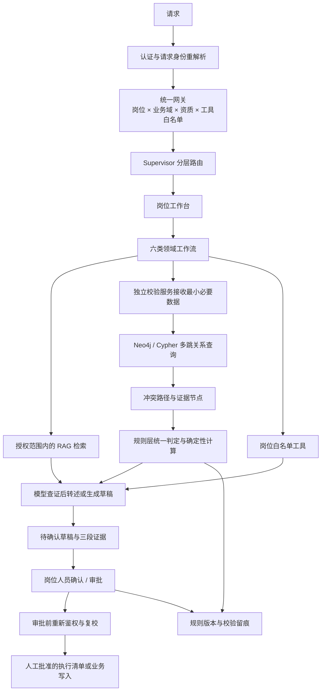

# 禾龄通六岗位权限与独立校验服务架构说明

[返回 Agent 设计目录](README.md)

> 更新依据：简历 v15（2026-11-10）。简历 v15 将项目一写作“禾龄通”；本文沿用仓库及项目文档中的“禾龄通”名称，并补充 Neo4j/Cypher 图事实层、RAG 工程指标及其与规则校验服务的关系。
>
> 范围边界：Agent 的“岗位工作台权限”和网站的登录账号角色是不同层次。本文不因简历描述而改写现有产品账号规划或宣称功能已上线；功能进度仍以项目需求、实施清单和对应验收记录为准。

## 1. 要解决的问题

养老院里的“全能助手”容易拿到过宽工具，也很难说清一次建议由谁负责、依据哪条规则、人工改了什么。v15 描述的架构把 Agent 限制为查资料、调用受限工具、转述确定性计算结果、写待确认草稿和提醒；开药、配餐、排班及最终审批仍由有权限的人员完成。

设计目标：

- 用岗位、业务域、资质和白名单约束每个工作台及工具。
- 把规则计算从大模型中拆出来，集中到可版本化、可复核的校验服务。
- 权限和业务边界在检索、MCP 和模型之前拦截；草稿审批时再校验一次。
- 保留人工确认、修改原因和最终决定，让评测可以检查全过程并支持回滚。

## 2. 组件关系



关键顺序是：先解析身份，再过网关，然后才进入 Agent 工作流、RAG、外部工具或模型。需要人工确认的写操作在审批前重新校验身份、草稿状态和规则版本。

简历 v15 将整体技术结构概括为三层：Agent 编排层负责按岗位和业务流程组织任务；规则校验层负责确定性判断；图事实层保存实体及其关系，为规则判断提供可追溯事实。图查询结果回到校验服务后，由规则层决定通过、拦截或要求补充资料，不能由模型直接把关系路径解释成“允许”。

## 3. 岗位工作台与领域工作流是两条轴

简历 v15 描述六岗位权限模型，并由 Supervisor 协调岗位工作流。工作台决定“谁能做哪些操作”；领域工作流描述“某类业务按什么步骤完成”。v15 没有列出完整岗位清单，也没有说明工作流数量，因此本文不推断存在六个领域工作流，更不把岗位工作台和领域工作流合并成六个全能 Agent。

简历列举的岗位边界示例包括：

| 岗位示例 | 主要职责 | 明确限制 |
| --- | --- | --- |
| 院长 | 审批、看板、复验 | 不开药、不设计食谱；审批时查看校验结论、冲突项和成本影响 |
| 医务室 | 用药资料查证、用药草稿和复核 | 不直接跳过校验、审批和执行清单步骤 |
| 食堂 | 指南查证、筛菜、营养与过敏原核对、配餐草稿 | 工具参数不包含老人 ID 或药品 ID，只接收脱敏禁忌结论 |
| 护理部 | 排班相关工作 | 只访问岗位授权的排班数据和工具 |
| 护工 | 执行清单、记录、上报 | 不调整剂量、不访问薪资工具 |

简历说明共有六个岗位，但没有逐一列出完整六岗位名称。完整清单、岗位 ID 和映射关系应由项目岗位映射表维护；在映射表补齐前不推断第六个岗位。

各领域工作流应独立维护，记录领域负责人、输入资料、校验服务和允许使用的工作台。跨岗位共享工作流时，权限从请求身份卡传入，由网关和业务服务再次校验。

### 多智能体协作与 ReAct 的边界

禾龄通的 Supervisor 在岗位工作台和领域工作流之间分派任务。医务室与食堂 Agent 不直接互相调用，跨部门协作由独立校验服务传递必要结论。这样仍是多智能体分层协作，但没有让专业 Agent 互相开放全部上下文和工具。

ReAct 是“观察结果—选择行动—执行工具—再看结果”的循环模式。若在某个工作流中使用，应把循环放在 LangGraph 的受控节点中；每一步重新检查网关授权、工具参数和调用预算，并设置最大步数、超时、终止状态。它不能绕过身份卡、校验服务或人工审批。

青禾的 Supervisor + 子 Agent 结构与禾龄通的岗位工作台结构有所不同，学习指南中单独说明其安全、饮食和主教练子图路由；不要把两种项目结构混成一个权限模型。

## 4. 身份卡和授权判定

身份卡是服务端为本次请求生成的身份与授权快照，至少包括：账号标识、岗位、业务域、资质职责、目标对象范围、工具白名单和允许的数据字段。身份卡不能由前端提交或由模型更改。

权限按以下条件共同判定：

```text
允许调用 = 岗位映射通过
         且业务域匹配
         且所需资质有效
         且工具在白名单中
         且目标对象和字段在授权范围内
         且当前业务状态允许该操作
```

任一条件缺失即拒绝，默认不授权。每个新请求重查身份和负责关系，不使用可能过期的老人关系缓存。模型生成的目标对象 ID 也必须由网关按当前身份卡校验。

网关覆盖聊天入口、普通业务 API、列表/详情/导出和 Agent 工具调用；只在前端隐藏按钮不构成权限控制。

对外可以统一使用“对象不存在或无权”，减少资源探测。内部审计保留明确原因：越权、对象不存在、资料不足或边界违规。普通系统故障另作服务错误记录，不能伪装成“无数据”。

## 5. 图事实层与独立系统校验服务

### 5.1 Neo4j 图事实层

简历 v15 描述在 Neo4j 中组织药品、成分、食物、过敏原、疾病、岗位、业务域和禁忌规则等节点及关系，并用 Cypher 查询多跳关系。食药冲突的示例路径是“药品 → 活性成分 → 冲突成分 → 食材”。查询结果包含冲突路径和证据节点，作为规则校验的输入依据。

图谱负责保存和查询关系事实，不能单独决定一项操作是否通过。节点和边应关联可核验来源、适用范围及版本信息；具体标签、关系类型和事实维护流程由实际图谱 schema 约定。按简历描述，图查询封装在校验服务内部，不向 Agent 暴露任意图查询工具。

### 5.2 确定性规则校验服务

系统校验服务不依赖大模型。它接收经过权限检查的最小必要数据，必要时查询 Neo4j 图事实，再执行版本化规则和数值计算，返回结构化结论及可解释依据。Agent 可以把结果整理成易读文字，但不能自行改写结果或把失败变成通过。

简历描述该服务作为医务室和食堂共享的协同中枢，避免把规则复制进多个 Agent 提示词。它以独立微服务通过明确接口提供能力；接口要约定输入范围、返回状态、规则版本、超时和故障处理。

四类检查包括剂量上限、营养目标达标、过敏原比对、食物与药物冲突。剂量和营养阈值由代码计算；图谱负责提供实体关系和冲突路径，规则层统一判定。简历还列出两个业务接口：返回脱敏后的禁忌结论，以及生成执行清单。食堂使用脱敏结论，不获得老人 ID、药品 ID 或完整用药清单。

### 5.3 规则版本和留痕

每次校验应能追溯：输入所需的数据版本、规则版本、结论、失败原因、冲突路径与证据节点、关联的草稿或业务单据、执行时间。图谱查询结果应关联到草稿校验记录，审批界面能展示适用依据，方便复核和复现。

规则版本必须固定在草稿上。审批时如果权限、业务状态、图谱事实版本或规则版本与草稿生成时不一致，就重新校验；不能把旧版“通过”结论直接套到新版草稿。

### 5.4 影子模式与故障策略

影子模式下，新规则先计算并记录结果，不改变原流程的业务决定。将结果与人工判断对照，分析误报、漏报和资料缺失；确认验收口径后再灰度启用拦截。

校验服务或必要图谱查询不可用时，涉及剂量、营养、过敏原或食药冲突的草稿禁止生成。系统应显示明确的待处理状态或转人工流程，不能让模型替代校验服务。

## 6. 领域工作流

### 6.1 医务室用药工作流

```text
查证 → 系统校验 → 生成草稿 → 人员确认 → 院长审批 → 执行清单
```

用药说明书检索按药品 ID、资料类别、生效时间过滤，输出带条号和原文位置的引用。草稿绑定校验记录；审批前重新检查操作者权限、草稿状态和规则版本。模型不能开药、调整剂量或绕开审批直接执行。

### 6.2 食堂食谱工作流

```text
查指南 → 筛选菜品 → 计算营养 / 比对过敏原 / 检查食药冲突
       → 生成草稿 → 再校验 → 人员审批 → 配餐清单
```

菜品和营养结果由可核验数据及规则产生。工具输入 Schema 禁止携带老人或药品标识；食堂工作台只读取校验服务返回的脱敏禁忌结论。审批时对草稿所依据的菜单、校验记录和规则版本再次复核。

### 6.3 护工执行与院长审批

- 护工工作台只挂执行、记录、上报工具。异常按类型转入对应工作流；护工不获得剂量调整入口。
- 院长工作台只挂审批、看板、复验工具。审批前复验权限、业务状态、规则版本，并展示校验结论、冲突项和成本影响。
- 岗位无权使用的工具不注册到该工作台，不只在前端隐藏；共享 API 仍须在服务端按当前身份卡校验。
- 医务室与食堂 Agent 不相互调用。跨部门只通过校验服务传递最小必要结论和事实。

## 7. 草稿、确认与人工修正

关键写操作采用分阶段流程：模型只创建草稿；人员核对并提交确认；有审批要求的事项再由审批岗位批准；最终由受限业务接口生成执行清单或完成写入。

人工确认分三级。每一级的风险定义、确认人、必填意见和升级条件应由业务规则维护；高风险确认必须写明意见。本文不自行设定剂量、营养或其他风险阈值。

关键决策保留三段证据：

1. Agent 原始建议。
2. 人员修改内容及原因。
3. 最终确认人、确认时间和决定。

人工修正台账按原因标签归入规则、Agent 工作流或人员培训问题，周度汇总、月度校准。修正数据不能未经审核就自动训练模型。确认页要区分“采纳”和“覆盖”，让评测能观察建议的实际使用方式。季度盲测、月度采纳率统计与证据完整率、决策可追溯率和异常闭环率一起复盘。

## 8. 灰度、双写与回滚

将旧角色权限改为岗位模型时，先维护明确映射表和工具白名单，再验证新旧判断差异。简历提到双写灰度；实施文档需要明确“双写”的对象：

- 如果新旧权限判断并行计算但只写一份业务数据，这是影子对比，应记录两套判定和差异。
- 如果确实同时写入新旧权限或业务记录，要定义权威数据源、事务或补偿方式、幂等键、差异对账和停止双写的时间。

灰度上线应能按岗位、领域或功能开关逐步放量，并预先定义停止和回滚条件。回滚时保留审计记录；已经过期或规则版本不匹配的草稿应重新校验，不应因回滚恢复为可直接执行。

## 9. 评测与验收口径

评测覆盖“是否得到正确答案”和“系统按什么顺序做事”。至少检查：

- 目标对象和身份卡先校验，越权请求没有触发 RAG、MCP 或模型。
- 岗位、业务域、资质任一不符合时拒绝；不允许的工具没有进入调用。
- 直接调用后端接口、伪造岗位、替换老人 ID 或遗漏资质时仍被拒绝，不能只靠前端控件拦截。
- 医务室和食堂工作流经过正确的校验节点；校验服务不可用时没有生成草稿。
- 食堂工具参数不含老人 ID 或药品 ID；跨部门数据只通过脱敏校验结论传递。
- 过期草稿、旧规则版本、权限撤销和重复确认均按预期处理。
- 异常路由和人工修正回流可从轨迹中核对；影子规则的盲测结果有记录。
- 图谱命中应返回预期的多跳关系路径和证据节点；缺失、过期或版本不匹配的关系不能静默当作“无冲突”。
- 青禾轨迹能证明安全风险优先拦截、账号由服务端绑定、工具摘要与依据可回看，且每轮不超过 4 次工具调用和 75 秒预算。

简历 v15 报告 FAISS + BM25 + RRF 的 Recall@10 约 85%、有效请求的工具调用成功率约 95%，以及在含人工复核的同任务口径下资料查证与草稿准备时间缩短约 30%。这些是简历报告的指标，不是对当前仓库的独立复测；验收时应核对召回集、成功率分母、任务范围和计时口径。

青禾简历报告 33 项后端回归、9 项前端测试，27 项 ReAct 回归中包含 11 项新增 Agent 测试。评测数字之外还要检查具体场景、断言内容和数据版本。

采纳率与证据完整率、决策可追溯率、异常闭环率一起观察。不能单独追求“建议被采纳”，否则容易让人工不敢指出 Agent 错误。

## 10. 需要维护的配置和术语

| 项目 | 应明确维护的内容 |
| --- | --- |
| 岗位映射表 | 完整岗位清单、岗位 ID、可访问业务域、资质要求和数据范围 |
| 工具白名单 | 工具名、读写类型、允许岗位、Schema、审计字段 |
| 校验规则库 | 规则版本、维护责任人、生效时间、适用范围、测试用例 |
| 风险与审批表 | 三级确认定义、审批岗位、必填理由、升级和退回条件 |
| 草稿状态 | 生成、待确认、待审批、已批准、已拒绝、过期、已执行等状态转换 |
| 评测集 | 越权、边界违规、规则冲突、过期草稿、异常路由、人工修正等场景 |

**身份卡**：一次请求的岗位和授权快照。  
**独立校验服务**：不调用大模型的确定性规则计算入口。  
**影子模式**：新旧规则同时观察，但新规则暂不改变业务决策。  
**三段证据**：建议、修改、确认的连续记录。  
**采纳率**：人员接受 Agent 建议的比例，应与安全和可追溯指标一起看。
