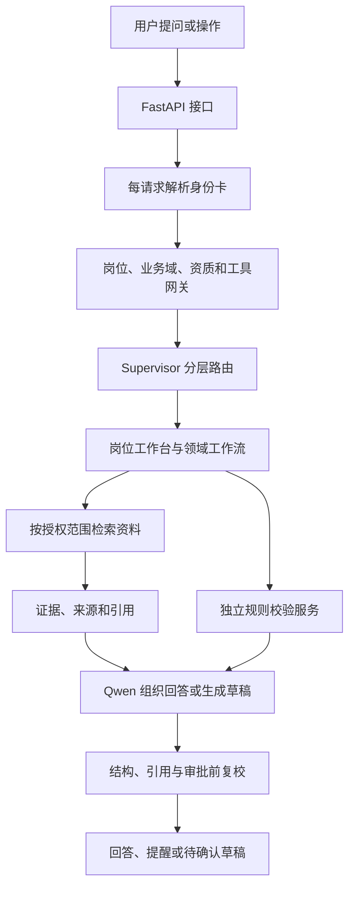

# 赖关瑞简历技术栈学习指南

[返回项目文档导航](../README.md)

这份指南按简历 v15 更新，把技术词拆成容易理解的概念，并说明它们在“禾龄通”和“青禾训练助理”两个项目里怎样配合。v15 简历把项目一写作“禾龄通”；本文沿用当前仓库和项目文档中的“禾龄通”名称。建议按章节顺序学习；每学完一部分，都尝试用自己的话讲清楚“它解决什么问题、输入是什么、输出是什么、失败时怎么办”。

> 范围说明：本文按简历 v15 整理。简历中的“六岗位工作台”属于 Agent 工作权限设计，和网站登录账号角色不是同一层概念；图谱、校验服务及性能数据按简历描述记录，不据此判断各项能力当前的代码落地状态。

## 先看全貌：一个 AI 应用是怎样工作的

可以把系统想成一个办事流程：后端先确认“谁在提问、能看什么”，再决定由哪个工作流处理；需要资料时去知识库检索，需要算数字时交给程序计算；最后才让模型把已有事实组织成好读的回答。



不是每个页面操作都要调用大模型。能用普通业务 API 完成的列表、看板和查询，就按授权范围直接读取。模型适合处理语言理解和表达，不适合决定用户权限、擅自编造事实或代替程序计算关键数字。

## 1. 先打好应用开发基础

### Python 3.11

Python 是简历中后端和 Agent 工作流使用的编程语言。3.11 是 Python 的一个版本号，选择具体版本有助于团队使用一致的语法、运行环境和依赖。

学习重点：变量、函数、类、异常、类型标注、虚拟环境、包管理、文件读写、HTTP 客户端和 `async` / `await`。做 AI 应用时，还要熟悉 JSON、日期时间、日志和配置读取。

### FastAPI 与异步接口

FastAPI 是用 Python 编写 Web API 的框架。API 可以理解为前端和后端之间的“办事窗口”：前端提交问题或数据，后端检查后执行，再返回 JSON。

- `GET` 通常用于读取，`POST` 通常用于提交或执行操作；具体语义以接口设计为准。
- 请求模型可以检查字段类型、必填项和格式。错误输入应尽早返回清楚的错误。
- 异步适合等待数据库、模型服务或外部工具响应的场景；它不会自动让 CPU 密集型计算变快。
- 调用模型和工具都要设置超时。上游服务卡住时，不能让请求无限等待。

### Pydantic、JSON Schema 与结构化输出

模型常会返回一段文字。程序若需要把它当作数据使用，就需要约定清楚格式。

- **Pydantic**：Python 中定义数据结构和验证数据的常用工具。比如要求周计划必须包含日期、动作列表和理由。
- **JSON Schema**：用 JSON 形式描述一个数据对象允许有哪些字段、字段类型和限制。
- **结构化输出**：要求模型按约定格式给结果，再由程序验证。格式不合格时先修复或拦截，不能直接拿错格式继续执行。

字段格式合法不代表内容正确。例如 `dose: 9000` 仍可能是一个格式合法、数值危险的 JSON。因此，格式校验之后还要做业务规则校验。

### SQLAlchemy 2、pytest、Git 与 Linux

- **SQLAlchemy 2** 是 Python 的数据库工具。它可以把数据库表映射成 Python 对象，也支持编写 SQL。ORM 方便处理常见数据读写，但理解 SQL、索引、事务和连接仍然重要。
- **pytest** 是 Python 测试工具。测试可以自动检查接口、权限、工作流分支和计算规则是否符合预期。
- **Git** 记录代码改动历史，帮助多人协作、查看差异和回退错误改动。常用概念包括 commit、branch、merge 和冲突处理。
- **Linux** 是常见的服务器操作系统。应会使用命令行查看文件、进程、日志、环境变量和运行服务。

## 2. 数据库：业务资料应该放在哪里

### MySQL 与 PostgreSQL

两者都是关系型数据库，适合保存有明确结构、需要准确增删改查的数据，例如账号、老人档案、训练记录、规则版本和会话记录。

建模时要想清楚：一条记录代表什么、它和其他表是什么关系、哪些字段必须唯一、哪些字段允许为空、谁可以看或改。主键用于识别记录，外键或业务约束用于维护关系。

简历中禾龄通使用 MySQL 8.0，青禾使用 PostgreSQL。学习时先掌握通用 SQL 和事务，再了解两种数据库的差异，不要一开始把应用逻辑绑死在某种数据库特有功能上。

### 参数化查询

把用户输入直接拼进 SQL 字符串，可能让输入改变 SQL 的含义，这类问题叫 SQL 注入。参数化查询把 SQL 结构和用户值分开提交，让输入按“数据”处理。

记住：搜索词、老人 ID、日期等来自用户的值，都应通过 ORM 或数据库驱动的参数机制传入；不要手工拼接成 SQL 代码。

### Alembic 数据库迁移

项目上线后数据库里已经有数据，改表不能只改 Python 模型。Alembic 用一份份有顺序的迁移记录描述数据库结构如何变化。

例如新增一个字段，可以创建迁移、在测试数据库执行、检查旧数据兼容性，再部署。每个迁移通常有“升级”和“回退”方向。生产环境迁移前还要考虑备份、锁表和失败恢复。

### 确定性计算和规则版本

确定性计算是指：输入和规则相同，程序每次都得出同样的结果。例如营养合计、剂量换算、金额、出勤统计、周训练容量、动作器械是否可用，都应该由明确代码和规则计算。

当业务规则调整时，记录规则版本或规则快照。这样日后才能说明当时为什么得到这个结果，并让“计算、解释、复核”使用同一版规则。模型可以解释程序算出的结果，但不要让模型凭语言猜数字。

## 3. 大模型与 Embedding

### Qwen 与 DashScope

Qwen 是简历使用的大模型系列。模型服务接收提示词和上下文，返回文本或结构化结果。DashScope 是简历使用的模型服务平台，也提供 Embedding 能力。

调用模型要处理网络失败、超时、额度、空响应和格式错误。密钥放在服务端配置中，不放在前端代码、仓库或普通日志里。

### Embedding（文本向量）

Embedding 模型把一段文字变成一串数字，叫向量。意思接近的句子通常会得到方向较接近的向量，方便用数学方法查找相似内容。

简历写的是 **1024 维 Embedding**，意思是每条文本被表示成 1024 个数。维度本身不代表答案质量；还要看模型、切块方式、知识范围和评测结果。更换 Embedding 模型或维度，通常需要重新生成向量并重建索引。

## 4. Agent 与 LangGraph：把模型放进可控流程

### Agent 是什么

Agent 可以理解为“模型加上工具和工作流程”。模型能理解用户表达、在允许范围内选择步骤；程序负责权限、数据访问、工具执行、业务规则和错误处理。能调用工具不等于模型拥有执行工具的全部权限。

### LangGraph 与 StateGraph

LangGraph 用图来描述一个工作流。图里的节点负责一项工作，边决定下一步走向。

- **StateGraph**：带有共享状态的有向图。
- **节点（Node）**：一个可执行步骤，例如识别意图、检索、生成、校验。
- **普通边**：步骤完成后固定进入下一个节点。
- **条件边**：根据结果选择不同分支，例如“证据足够就生成，否则追问”。
- **状态（State）**：节点间传递的数据。需要明确哪些节点能读、哪些节点能改，避免把不同含义的信息混在一起。
- **状态合并**：多个节点的结果写回共享状态时，要定义哪些字段可合并、冲突时以谁为准；否则后一步可能读到丢失或互相覆盖的数据。

简历里提到状态合并和子图编排。共享 State 要明确每个字段由哪些节点读写，以及并行节点如何合并结果。可以把用户已确认的条件、检索证据和权限身份分开保存；用户或权限范围变化后，不能沿用旧请求中的授权结论。

### ReAct 循环

ReAct 可以理解为“观察信息 → 选择行动 → 执行工具 → 看结果 → 再决定下一步”。模型提出行动，后端才真正执行工具，再把结果交回工作流。它适合需要多步查资料或调用工具的任务；LangGraph 负责把这段循环放在受控的图里。每轮都要经过白名单、权限、参数和预算检查，并设置最大步数、超时和清楚的停止条件，避免循环失控。遇到安全门禁或无权请求时，应立刻退出循环。

青禾 v15 的简历示例把 8 类教练工具放入白名单，并限制单轮最多调用 4 次、单次工作流预算 75 秒；服务端绑定账号，模型不能指定 `user_id`。简历报告 27 项 ReAct 相关回归，覆盖预算、参数注入、账号隔离和草稿确认。这个例子说明“能多步行动”必须配有明确的工具范围、次数上限、总时限和失败处理。

### Supervisor、工作台和子 Agent

- **Supervisor**：像分诊台，在身份和权限已检查后，把请求路由到合适的领域工作流。它负责分发，不代替业务校验，也不应该扩大工作流权限。
- **岗位工作台 Agent**：按实际岗位提供不同入口和工具集合。简历列出的岗位示例包括院长、医务室、食堂、护理部和护工；简历提到六个岗位，具体岗位名单应以岗位映射表为准。
- **岗位工作台与领域工作流是两条轴**：工作台决定“这个人能处理哪些操作”；领域工作流决定“这个业务怎么完成”。同一领域流程可以被不同岗位以不同权限使用。
- **子 Agent**：把一个领域任务单独拆出来，例如饮食或塑形。子 Agent 应有独立上下文和有限权限。
- **agent-as-tool**：把子 Agent 包装成某个工具，主流程按约定的输入调用它，并接收结构化结果。
- **子图（Subgraph）**：把一组节点封装成可复用的小流程，适合把复杂任务分成边界清楚的部分。

多智能体协作不是“让多个模型随意互相聊天”。Supervisor 负责分派，子 Agent 各自只处理一个有限领域；调用前检查权限，调用后按结构化结果交接。需要跨部门的事实时通过指定服务传递，不把完整老人资料或任意自然语言摘要扩散给所有 Agent。

跨 Agent 传递结构化事实比传一大段自然语言摘要更容易检查。例如传 `kcal_target`、`protein_g`、`basis` 等字段，接收方能验证字段和值，而不是猜摘要里哪些是事实。

青禾的路由先按规则处理医疗和安全请求，再把饮食、热量和蛋白质请求送到 diet 子图，其余回到主教练；模型只在有限类别里补充分流，输出必须通过枚举和 Schema 校验，无法判断时回到主教练。这个顺序让高风险分支不依赖模型自由猜测。

### interrupt 与 checkpoint 恢复

有些操作需要用户确认后才能继续，例如发布周计划或写入业务数据。`interrupt` 可以让工作流停在待确认位置；checkpoint 把恢复所需的工作流状态保存下来；用户确认后再从保存点继续。

恢复时还要重新检查用户身份、数据归属、草稿版本、有效期、来源指纹和当前状态。保存了旧状态不代表旧权限仍有效。重复点击确认也应幂等，即同一个确认请求不会重复写入。

### Planner–Executor–Critic

这是把“出计划”和“验证计划”分开的做法：

1. **Planner（计划器）**产出符合格式的草案。
2. **Executor（执行器）**把草案中的动作、设备和日期映射到真实数据，并执行程序规则检查。
3. **Critic（检查器）**判断计划是否违反容量、伤病禁忌、相邻训练日重复肌群等规则。

未通过时，把具体原因交回 Planner 修改；设置最大重试轮数，避免反复调用模型。容量变化、禁忌和设备可用性由项目规则明确，不能把某个项目的限制当成通用健身标准。

## 5. 让回答可靠：格式、证据、门禁和预算

### 槽位校验与澄清

槽位就是完成一项任务所必需的信息。例如生成训练计划需要训练目标、可用器械和身体限制；如果缺少关键信息，就追问用户，而不是让模型自行补齐。

对日期、年龄、数量、老人 ID 等内容，校验格式和业务范围；有歧义时先确认。用户确认后的信息才进入对话状态。

### Grounded 生成与引用

Grounded 意思是回答必须有依据。先检索可用资料，再要求模型只根据证据回答；每条引用应能回到来源文件、条款或原文位置。

“回答附了引用”不自动证明内容正确。还应检查引用是否支持对应句子、引用编号是否真实、原文位置是否能打开。资料没查到、命中内容不够或用户没有权限时，应说明限制或追问，不能编造一个听起来合理的答案。

要区分三种情况：**零命中**表示没有找到候选资料；**命中不充分**表示找到了相关内容，但不足以回答完整问题；**范围受限**表示可能有资料，但当前用户不能查看。它们原因不同，用户提示和内部审计也应能区分。

### Self-Correction

Self-Correction 是发现草稿问题后尝试修正、拦截或兜底。可靠流程应由程序指出明确的问题，例如 JSON 字段缺失、数字没有证据、动作不在动作库；修正次数有限。模型说“我检查过了”本身不是验证。

### 安全门禁前置

安全门禁是在工作流前面或关键节点检查不能继续的情况。例如身份未确认、用户无权访问、运动健康红线或紧急风险。若命中规则，应优先暂停、提示或转人工；不应该先让模型自由生成建议，再寄希望于它自己发现风险。

### Planner–Critic 重试与预算

给每次请求限制工具调用次数、模型调用次数、最长时间和返回大小，称为预算。预算既控制成本，也防止失控循环。达到上限时要给出明确结果，例如“暂时无法确认”，而不是默默超时或返回半成品。

## 6. RAG：先查资料，再组织答案

RAG 是检索增强生成（Retrieval-Augmented Generation）。它不是重新训练大模型，而是在回答前找到相关资料，把资料片段和来源交给模型参考。

### RAG 的基本步骤

1. **解析文档**：从 PDF、Word、网页等提取文字和元数据。扫描版 PDF 可能要先 OCR；提取失败不能假装内容完整。
2. **切块（Chunking）**：把长文切成适合检索的小段。递归切块会尽量沿着标题、段落、句子等边界拆分。
3. **重叠（Chunk overlap）**：相邻块保留少量重复文字，减少关键信息刚好被切断的情况。重叠过多会增加索引体积和重复结果。
4. **保存字符偏移**：记录片段在原文中的起止位置，才能把命中的块准确对应回原文、条款或页面。
5. **生成 Embedding**：把片段变成向量，用于语义相似度检索。
6. **关键词检索**：同时按词语匹配资料，补足向量检索对编号、专有名词和精确字词的不足。
7. **过滤与融合**：先按权限、领域和元数据过滤，再融合多路结果、判断证据是否足够。
8. **带引用生成**：只把允许使用的片段交给模型，返回可核对的来源。

### FAISS 向量检索

**FAISS** 是用于向量相似检索的工具库。简历 v15 没有限定具体 FAISS 索引类型。检索命中仍要能对应回原文片段。

FAISS 的索引本身不是权限系统。应在检索前或检索过程中按授权条件过滤候选资料，不能检索出无权内容后再指望模型隐藏它。

简历报告 Recall@10 约 85%。Recall@10 可以理解为：对一批测试问题，前 10 个结果找回的相关资料占已知相关资料的比例。这个数要结合测试问题和相关资料标注一起看；它衡量的是召回，不代表答案正确率。

简历还描述每个知识库设置 20 万条向量的容量保护，并使用索引版本化、原子发布和热加载。容量保护是系统设定的上限防护，不是 FAISS 的通用硬限制。原子发布可以理解为先在后台完整建好新索引，确认可用后再一次性切换；热加载让服务加载新版本时不必停掉整条问答链路。

### BM25 与 jieba

BM25 是按关键词匹配程度给文档排序的方法。中文通常没有空格分词，所以简历使用 jieba 把句子切成词，再做关键词检索。

BM25 擅长找准确字词、药品名称、条款号；向量检索擅长找说法不同但意思相近的内容。两者可以互补。

### RRF 融合

RRF（Reciprocal Rank Fusion，倒数排名融合）根据不同检索结果中的名次合并排序。一个常见形式是：

```text
融合分数 = Σ 1 / (k + 该文档在某一路检索中的名次)
```

它不用直接比较 BM25 分数和向量分数的大小，适合把两套排名合起来。融合后仍要去重，并检查来源和权限。

### Neo4j、Cypher 与知识图谱

知识图谱适合表达“哪些实体之间存在什么关系”。**Neo4j** 是图数据库，实体通常保存为节点，实体间的关系保存为边；**Cypher** 是查询 Neo4j 的语言，可以沿着关系找出一条或多条连接路径。

简历 v15 描述的养老平台图谱包含药品、成分、食物、过敏原、疾病、岗位、业务域和有版本的禁忌规则等事实。比如系统可以沿“药品 → 活性成分 → 冲突成分 → 食材”查出多跳关系，并返回冲突路径及相关证据节点。具体节点标签、关系名称和数据来源应以项目实际图谱 schema 为准。

图谱查询回答的是“有哪些已记录的关系和证据”，不会自动替业务作出最终决定。独立规则服务根据图谱事实和版本化规则统一判定；剂量上限、营养是否达标等数值仍由普通程序按明确公式计算。按 v15 的设计，Agent 不直接拿到任意图查询工具，图查询在校验服务内部完成，结果关联到草稿校验记录供审批复查。

图谱与 RAG 分工不同：FAISS、BM25 和 RRF 用来从说明书、指南等文字资料中找相关片段；Neo4j 用来查询药物、成分、食材等实体之间的关系。两种结果都要保留来源或证据，不能把“查到一条边”当成规则已经通过。

### 元数据过滤、CRAG 与索引版本

- **元数据过滤**：按领域、药品 ID、条款号、生效时间和可见范围等条件缩小候选资料。FAISS 与 BM25 应使用一致的授权过滤条件。
- **CRAG**：Corrective RAG 的思路之一，在生成前判断检索质量；证据不够时可改写查询、继续检索、按授权联网，或明确告知资料不足。
- 简历青禾项目使用词项覆盖率判断资料是否充分。阈值应根据真实问题和错误案例校准，不能把某个固定值当成所有知识库的通用标准。
- **Tavily**：青禾简历列出的联网搜索服务。仅在本地资料不足且用户授权时调用；只查白名单域名，只发送本轮问题文本，并把外部网页当作待核验来源，不能直接当成权威结论。
- **索引版本化重建**：保存索引使用了哪版文档、切块方式、Embedding 模型和元数据。规则或内容改变后能明确重建、回滚和追踪。
- 青禾项目将 BM25 作为常驻检索，用户授权后再叠加 Chroma 向量检索并用 RRF 融合。简历报告知识库文档支持 TXT、Markdown、文字 PDF 和 DOCX，单文件上限 10 MiB；索引失败时保留原文和 BM25 检索能力，并允许重试重建。
- 文档去重、切段、来源记录和内容哈希用于避免重复处理，并让检索结果能对应回具体版本。简历也提到按知识库权限隔离索引；检索前就要按用户授权过滤，不能靠模型隐去已召回的无权内容。

### FAISS 和 Chroma 的关系

简历里两个项目用了不同选择：禾龄通采用 FAISS，青禾采用 Chroma。两者都能帮助保存和检索向量，但使用方式和附带功能不同。初学时应理解“向量检索、原文 ID、元数据过滤、索引更新”这些共同概念，再根据项目需求选择，不能认为换数据库就自动提高回答质量。

## 7. 工具调用、MCP 与统一网关

### Function Calling

Function Calling（函数调用）是让模型从一组已提供的函数说明中选择函数，并按指定参数格式返回调用请求。真正执行函数的是后端程序，不是模型本身。

后端仍要验证函数名是否允许、参数是否完整、当前用户是否有权限、调用是否超时、返回是否超大。不能因为模型“选了这个工具”就跳过检查。

简历 v15 报告禾龄通“有效请求”的工具调用成功率约 95%。这个比例只说明符合调用条件的请求有多少顺利完成工具调用，不等于答案正确率，也不代表所有用户请求都应该成功调用工具。

### MCP 与 MCP Python SDK

MCP（Model Context Protocol）是一种让 AI 应用发现和调用外部工具、读取资源的通用协议。它帮助客户端与工具服务约定如何描述能力、参数和结果。**MCP Python SDK** 是 Python 程序接入 MCP 服务时使用的开发库。简历 v15 没有限定具体传输方式；无论工具通过何种方式连接，协议都不替代身份验证、授权、参数校验和审计。

MCP 是连接工具时使用的协议；微服务是把系统拆成若干独立职责服务的架构方式。两者不是一回事：一个校验微服务可以提供 HTTP API，也可以由适配层包装成 MCP 工具，但不应因此绕过本地权限网关。

### 工具注册表和网关

**白名单注册表**预先登记允许调用的工具、参数模型、超时、读写类型、角色和调用预算。**统一网关**在真正执行前集中做权限与 Schema 校验、超时控制、返回大小限制、有限重试和记录来源。

网关应把无权调用、没有数据、校验未通过和服务故障分开记录；这些情况原因不同，后续处理也不同。MCP 负责约定如何发现和传递工具信息，不替代本地网关的权限判断。

青禾工具调用由后端根据登录会话绑定账号，模型不能在参数里替换成另一个 `user_id`。工具摘要和依据也保留在输出里，方便用户理解建议从哪里来。

## 8. 独立系统校验服务

禾龄通简历把关键数字和业务规则交给独立校验服务。它按明确规则计算和判断，不调用大模型；模型可以转述校验结论，但不能替代校验服务。

**微服务**是边界清楚、可以独立运行和发布的服务。独立校验服务只负责规则计算，通过明确的接口接收必要数据并返回结果，医务室和食堂共用同一规则来源。服务边界要定义输入、输出、版本和错误状态；调用端要处理超时、不可用和结果版本不匹配。

简历列出的四类检查是剂量上限、营养达标、过敏原比对、食物与药物冲突；两个业务接口是返回脱敏后的禁忌结论，以及生成执行清单。校验服务应返回校验状态、规则版本、可解释原因和可追溯记录，避免只返回一个无法复核的“通过”。

规则版本化表示每次计算都能说明用了哪版规则。校验留痕保存必要输入摘要、规则版本、结论和关联草稿，便于复现。规则更新后，旧草稿不能静默沿用新旧混杂的校验结果。

**影子模式**是先运行新校验、记录“如果启用会怎样判”，暂不让它改变业务结果。把影子结果与人工复核对照，排查误报和漏报，再按灰度计划逐步启用拦截。影子模式不是放过已知高风险操作的理由；高风险业务仍需既有安全措施。

如果校验服务不可用，相关草稿应停止生成或进入明确的人工处理流程，不能让大模型猜一个替代结果。

## 9. 岗位权限、身份卡与安全边界

### 身份卡和四个授权条件

简历使用“身份卡”指后端对本次请求重新解析出的身份与权限信息。它至少要能说明当前账号、岗位、业务域、资质职责、数据范围和可用工具。身份卡由服务端生成；前端和模型都不能修改它。

授权由“岗位 × 业务域 × 资质 × 工具白名单”共同决定。四项都符合才放行，任何一项缺失或不匹配就拒绝，这叫默认拒绝。岗位名称不是权限本身，必须有明确映射规则。

### 每次请求重解析，网关先拦截

每个新请求都重新读取身份和老人关系，不把可能已变更的关系长期缓存。请求到达后先过统一网关，校验岗位、业务域、资质、目标对象和工具白名单，再决定是否允许进入 RAG、MCP 或模型。

院长只能审批；医务室处理用药；食堂处理食谱；护理部处理排班；护工执行、记录和上报。简历提到六个岗位，完整名称和映射应以岗位映射表为准，不能凭空补写缺少的岗位定义。

网关对外可以统一返回“对象不存在或无权”，避免泄露敏感对象是否存在；内部审计仍要区分越权、不存在、资料不足和边界违规。不要把“工具没权限”“确实没有数据”“资料不够”和“系统出错”混为同一种结果。

### 最小权限与跨部门数据

- 每个工作台只登记完成岗位工作的必要工具。院长不提供开药或设计食谱的入口，护工不提供剂量调整和薪资工具。
- 不允许的岗位工具不应注册到工作台或对外暴露对应操作入口；共同 API 仍必须由后端再次校验，不能只靠前端隐藏按钮。
- 工具参数 Schema 限制允许传入的字段。食堂工具不收老人 ID 和药品 ID，只接收校验服务提供的脱敏禁忌结论。
- 两个专业 Agent 不互相调用；跨部门只经过独立校验服务传递结论和必要事实。

## 10. 人工兜底与修正校准

Human-in-the-loop（人在闭环中）是让人员在关键步骤审核、修改或批准 Agent 草稿，再由系统记录决定并继续流程。人工确认不是让人无条件替 Agent 收尾，而是按风险决定何时、由谁、带着什么证据确认。简历提出三级确认；具体哪些业务属于哪一级，要写入项目的风险规则和岗位流程，不能只靠提示词临时决定。高风险确认需要记录审核意见。

关键决策保留三段证据：**Agent 建议 → 人员修改 → 人员确认**。这样能区分“直接采纳”和“修改后覆盖”，复盘时看得出人为什么改、最后由谁确认。

简历 v15 报告，在同一任务且采用包含人工复核的统计口径下，资料查证和草稿准备耗时比人工流程缩短约 30%。比较效率时要把人工复核算在内，不能用省掉审批的方式制造更快的数字。

人工修正台账记录原建议、修改结果、原因标签和最终确认。按简历的节奏，周汇总修正问题、月度校准；再把问题归到规则、Agent 流程或人员培训三条改进路径。修正记录先经人工分类和验证，不能未经审核就自动拿去训练模型。

**盲测**是让审核者在不知道系统输出或预期答案的情况下独立判断，再比较结果，减少“看到 Agent 答案后跟着选”的偏差。简历提到季度盲测、月度统计采纳率。**采纳率**是人员接受 Agent 建议的比例，不能单独当作成功指标；还要结合证据完整率、决策可追溯率和异常闭环率，避免为了提高采纳率而压低人工质疑。

## 11. 两个项目里的确定性规则与安全

### 青禾：训练计划规则

模型生成训练计划草案，程序检查可执行性和安全规则。

- 动作必须来自动作库，不能编造一个数据库中不存在的动作。
- 器械必须是用户实际可用的设备。
- 周容量、伤病禁忌、相邻日重复肌群等由程序按规则检查。
- **RPE**（Rate of Perceived Exertion）是主观用力程度评分，帮助理解训练者觉得一组训练有多吃力。它是用户记录的信号，不应单独被当作医疗诊断。
- 恢复和症状信息要经过安全筛查。命中预先定义的红线时，应持久化暂停相关计划或转人工处理；恢复前重新检查用户、计划和状态。
- 缺少记录应标记为“未提供”，不能随意当成 0。零和未知是两种不同的数据状态。

涉及剂量、营养或健康风险时，模型可以帮助组织解释，但关键数值和禁忌应由经过审核的规则及程序处理；实际照护和医疗决策应遵循专业人员与机构流程。

## 12. 前端：Vue 3、TypeScript 与 ECharts

- **Vue 3**：用组件组织网页界面。组件可以是登录框、老人列表、餐食表格、训练计划卡片等。响应式数据变化后，界面会更新。
- **TypeScript**：给 JavaScript 加上类型检查。接口返回类型明确后，较容易发现字段名写错、空值没处理等问题。类型检查不能替代后端校验。
- **ECharts**：把数据画成图表，适合展示体测趋势、统计指标和图形化数据。图表必须基于真实数据，并标明单位和时间范围。
- 前后端分离时，前端负责展示、收集输入和调用 API；权限、字段过滤和最终业务校验仍必须在后端完成。

## 13. 测试、评测和轨迹

### pytest 与后端测试

pytest 自动执行可重复的代码检查。常见测试包括：

pytest 是简历技能和禾龄通项目使用的测试框架；青禾项目技术栈列出 `unittest`。两者都能写自动化测试，学习时要先理解测试输入、预期结果和断言，再熟悉项目实际使用的框架。

- 函数和业务规则的单元测试。
- API 输入、输出、认证和权限的接口测试。
- API 安全测试：伪造岗位、替换老人 ID、缺少资质或直接请求未授权接口时，服务端都应拒绝。
- Agent 节点和分支的工作流测试。
- 数据库迁移和工具异常的集成测试。
- 回归测试：修复一个旧问题后，确认它不会再次出现。

简历 v15 报告青禾完成 33 项后端回归、9 项前端测试；27 项 ReAct 相关回归中包括 11 项新增 Agent 测试，覆盖调用预算、参数注入、账号隔离和草稿确认。这些数字是简历描述的项目数据；学习时还要看用例覆盖了哪些场景和失败边界，而不只看总数。

青禾把饮食目标和下周计划保存为 PostgreSQL 草稿，有效期为 15 分钟。确认时通过行锁避免并发确认，再检查归属、状态和源指纹；数据变化或草稿过期就拒绝写入。写入前回读核对，重复确认保持幂等，取消操作不改动原有计划。工作流恢复成功不代表草稿仍有效，必须重新核对。

### 固定评测集

固定评测集是一组长期保留的问题和期望行为。调整提示词、模型、检索或规则后，重复运行同一批用例，观察答案和关键行为是否变差。

评测不只看最后一句回答，也可以检查：是否先验证权限、是否调用正确工具、越权时是否没有触发检索和生成、引用能否回到原文、调用是否在预算内。

### 轨迹级断言

轨迹（Trace）是一次请求经过哪些节点、调用了哪些工具、每一步结果如何的记录。轨迹级断言可以检查调用顺序和行为，例如“先过安全门禁”“需要时调用恢复摘要”“流程在有限步内收敛”。

轨迹记录要注意不保存不必要的敏感信息或模型密钥。禾龄通按岗位、跨岗位边界、草稿过期、异常路由和修正回流检查；青禾按训练、饮食和塑形分域评测，避免平均分掩盖某一类失败。还要盲测校验服务结果，并观察人工采纳和修正情况。

## 14. 部署和交付里的工程细节

- **配置与密钥边界**：开发、测试和生产环境使用各自配置；实际 API 密钥放在安全配置中，不提交 Git。
- **前后端独立交付**：前端构建出静态资源，后端作为服务运行；二者通过明确的 API 合同协作。
- **本地部署**：开发者在自己的机器启动数据库、后端和前端，检查环境配置和迁移步骤。
- **配置与规则版本**：记录关键配置、规则、知识索引的版本，出错时可以定位是哪一版行为导致结果变化。
- **影子与灰度发布**：先观察新规则和旧流程的差异，再逐步切换部分业务；为每一步规定停止条件、回滚条件和负责人。
- **双写或双轨核对**：改造存量权限时，如果需要同时维护新旧映射，要定义唯一数据源、幂等规则、差异对账和退出时间；如果只是并行比较判断结果，应称为影子核对，不要把两种方案混为一谈。
- **文档和测试清单**：让其他人能安装、启动、验证和排查问题，减少“只有作者电脑上能运行”的情况。

## 15. 简历里其他技术经历

- **Android App**：面向 Android 设备的应用开发实践。
- **HarmonyOS App**：面向华为 HarmonyOS 生态的应用开发实践。
- **Java Web**：用 Java 开发 Web 服务或网站后端的实践；与简历主项目里的 Python FastAPI 栈不同，但 HTTP、数据库、接口和分层等概念可以迁移。
- **ACM 竞赛训练**：训练算法、数据结构、复杂度分析和限时解题能力。这些能力对优化程序有帮助，但实际工程还要考虑可读性、测试、错误处理和维护。
- **智能小车社团与竞赛**：通常涉及硬件、传感器、控制逻辑或嵌入式实践；简历没有列出具体板卡和技术细节，因此这里不推断使用了哪种芯片或语言。

## 16. 建议学习顺序与练习路线

按下面的顺序做一个小型“知识问答 + 训练计划草稿”项目，每一步都先做最小可运行版本：

1. **语言与 API**：复习 Python、类型标注、FastAPI、Pydantic；做一个收发 JSON 的接口。
2. **数据库**：建账号、资料、会话三张表；使用 SQLAlchemy 做参数化读写，再用 Alembic 新增一列。
3. **测试**：用 pytest 或 `unittest` 检查接口和数据库操作，再为权限失败、空结果和错误输入加测试。
4. **前端**：用 Vue 3 + TypeScript 做一个输入框、结果列表和错误提示；从前端调用 FastAPI。
5. **RAG**：导入一份公开文档、切块、保存来源和字符偏移；做 BM25，再加入 Embedding 和 FAISS 或 Chroma。
6. **证据和引用**：要求答案引用具体片段；测试资料不足、越权资料和引用错位时系统如何反应。
7. **LangGraph 与多智能体**：先做“解析问题 → 检索 → 生成 → 校验”的图，再加 Supervisor 和受限子 Agent；需要多步工具时再做有界 ReAct 循环。
8. **权限与工具**：引入身份卡、岗位/业务域/资质映射、工具白名单和统一网关；确认越权请求没有触发模型或检索。
9. **独立校验与人工审批**：把一项纯规则校验封装成微服务，再让草稿走 Human-in-the-loop 的确认流程，加入 interrupt / checkpoint、再次授权、有效期和幂等处理。
10. **评测与交付**：建立固定问题集和轨迹检查；先用影子模式比较规则，再按灰度和回滚方案逐步启用。

每个阶段都要练习失败路径：数据库断开、模型超时、没有检索结果、用户权限撤销、用户重复确认。能解释失败时系统怎样停下来，才算真正理解了技术链路。

### 两个项目怎样组合这些技术

| 项目 | 技术组合 | 学习时重点看什么 |
| --- | --- | --- |
| 禾龄通（v15 简历称“禾龄通”） | FastAPI、LangGraph、Qwen 与 DashScope Embedding（1024 维）、Neo4j + Cypher、FAISS + BM25 + RRF、MCP Python SDK、MySQL 8.0、Alembic、Vue 3 + TypeScript、pytest | 三层结构：图事实、规则校验、Agent 编排；六岗位网关、多跳冲突证据、索引版本化/原子发布/热加载 |
| 青禾训练助理 | FastAPI、LangGraph ReAct、Qwen 与 DashScope Embedding、BM25 + Chroma + RRF、CRAG + Tavily、PostgreSQL、Vue 3 + TypeScript + ECharts、unittest | 8 类白名单工具、单轮 4 次/75 秒预算、账号由服务端绑定、确认式草稿与索引故障降级 |

这些组合是简历中的项目技术描述。先学每项技术的基本原理，再对照项目设计文档和验收记录理解组件之间的数据输入和输出。

## 17. 自测：学完后能不能讲明白

1. 为什么权限要在检索和模型生成之前检查？
2. Embedding 检索和 BM25 各自擅长找什么？RRF 做了什么？
3. 引用编号存在，为什么还需要检查它是否真的支持回答？
4. 模型生成的 JSON 结构合法，为什么仍不能直接写入数据库？
5. 身份卡里的岗位、业务域、资质和工具白名单分别限制什么？
6. 为什么同一条老人关系需要在新请求或审批前重新确认？
7. interrupt 保存了工作流状态，为什么恢复时还要检查权限和草稿版本？
8. 校验服务不可用时，为什么不能让大模型代替它给出通过结论？
9. 影子模式、灰度发布和回滚分别解决什么问题？
10. 采纳率为什么不能单独作为 Agent 成功指标？
11. 哪些数字应由程序计算，哪些工作适合交给大模型？

## 18. 术语速查

| 术语 | 简单解释 |
| --- | --- |
| Agent | 大模型加上工具和受控工作流程 |
| API | 前后端之间约定好的请求与返回方式 |
| BM25 | 根据关键词匹配程度排序文档的方法 |
| Checkpoint | 可供工作流暂停后恢复的状态记录 |
| Chunk | 从长文档切出来的一段文本 |
| Embedding | 把文本转换成数字向量的表示 |
| FAISS | 用于向量相似检索的工具库 |
| Neo4j | 用节点和关系保存、查询实体关联的图数据库 |
| Cypher | 描述 Neo4j 图查询的语言 |
| Recall@10 | 在前 10 个检索结果中找回相关资料的比例 |
| unittest | Python 自带的自动化测试框架 |
| Grounded | 回答内容有可检查的证据支持 |
| MCP | AI 应用连接外部工具和资源的协议 |
| Human-in-the-loop | 在 Agent 流程关键点由人员复核、修改或批准 |
| ReAct | Agent 根据观察结果反复选择并执行受控行动的流程 |
| 微服务 | 通过明确接口独立运行、负责一项清楚职责的服务 |
| 多智能体协作 | Supervisor 把任务分给权限受限的专用 Agent，再按约定结果汇总 |
| 身份卡 | 后端每次请求重新解析出的岗位、业务域、资质和范围 |
| RAG | 回答前先从资料中检索证据，再让模型组织答案 |
| RRF | 根据多路检索排名融合结果的方法 |
| Schema | 对数据字段、类型和限制的结构说明 |
| Trace | 一次请求经过的节点、工具及结果记录 |
| 确定性计算 | 相同输入和规则会得到相同结果的程序计算 |
| 幂等 | 同一操作重复执行，不会造成重复副作用 |
| 影子模式 | 先记录新规则的判断结果，与现行流程对照，暂不改变业务结果 |
| 规则版本 | 计算结论所依据的一套明确规则编号 |
| 三级确认 | 按风险配置不同审核强度的人工确认机制 |
| 三段证据 | Agent 建议、人员修改、人员确认的连续记录 |
| 采纳率 | 人员接受 Agent 建议的比例，需与质量和安全指标一起看 |
| 元数据 | 描述资料本身的信息，如领域、来源、时间和权限范围 |
| 槽位 | 完成一项任务所需要的关键输入字段 |
